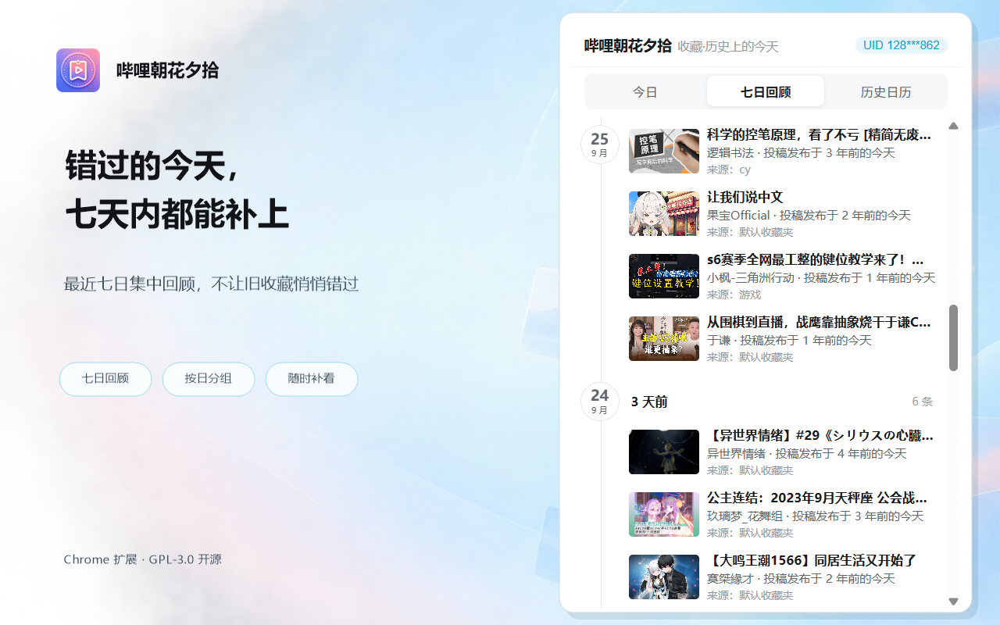
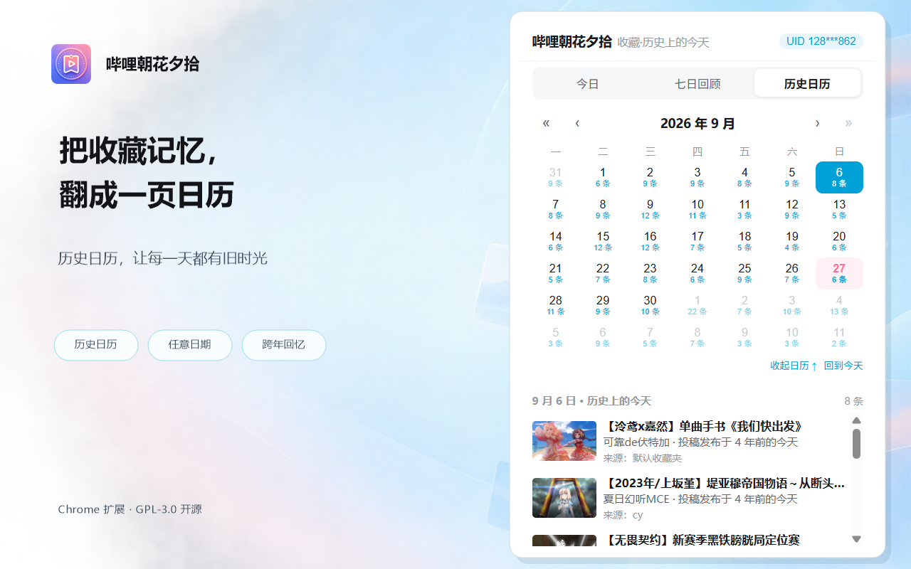

<p align="center">
  
</p>

<h1 align="center">哔哩朝花夕拾</h1>

你收藏的视频，也许已经陪伴了你好几年。

哔哩朝花夕拾，带你重温收藏夹里历史上的今天。

> 🛒 **一键安装**：[Chrome 应用商店 · 哔哩朝花夕拾](https://chromewebstore.google.com/detail/kgamlldkccpldahaohnbnnfdnegphppe)

> 当前版本：**v1.3.0**

> Chrome 应用商店的更新需要审核，商店版本可能比 [GitHub Releases](https://github.com/Skwater/bilibili-fav-anniversary-reminder/releases) 晚几天，个别情况可能更久；实际可安装版本以商店页面显示为准。






> 本扩展为非官方开源项目，与哔哩哔哩无关联。
> 本项目由 **DeepSeek（AI）与 OpenAI Codex 参与设计、实现与维护**，仅供学习交流参考。

---

## 主要功能

- **历史上的今天**：在哔哩哔哩首页和扩展弹窗中，回顾往年今日发布的收藏视频。
- **七日回顾与历史日历**：补看最近七天，或选择日期浏览历史投稿。
- **稍后再看**：一键添加或移除想重温的视频。
- **自由同步**：选择自建或追更收藏夹，支持手动同步和自定义同步周期。

## 使用方法

在浏览器中登录哔哩哔哩，点击扩展图标，选择收藏夹并完成首次同步。之后无需保持哔哩哔哩网页打开，即可使用扩展查看回顾和管理稍后再看。

## 隐私

收藏缓存与设置保存在本地，不上传开发者服务器；登录凭据仅用于哔哩哔哩接口请求。详见[隐私政策](PRIVACY.md)。

项目地址：[Skwater/bilibili-fav-anniversary-reminder](https://github.com/Skwater/bilibili-fav-anniversary-reminder)

> 同步节流与风控处理的设计参考了 [BiliShelf](https://github.com/TLRKFXE/BiliShelf)，本项目根据自身同步流程独立实现。

## 安装

**方式一：Chrome 应用商店（推荐）**

前往 [哔哩朝花夕拾 · Chrome 应用商店](https://chromewebstore.google.com/detail/kgamlldkccpldahaohnbnnfdnegphppe) 点「添加至 Chrome」，之后会自动更新。

**方式二：本地开发加载**

1. Chrome/Edge 打开 `chrome://extensions`，右上开启「开发者模式」；
2. 点「加载已解压的扩展程序」，选择本目录的 `extension/` 文件夹；
3. 在浏览器中登录哔哩哔哩后，点击扩展图标，选择收藏夹并开始首次同步。

首次同步的选择和进度都显示在插件弹窗中；完成后切换到日常界面。首页右下角只在有每日命中时提醒。首次使用可能需要较多时间。

> 说明：登录态来自浏览器中的 B 站 Cookie。已登录后，即使没有打开 B 站页面，也能读取收藏夹、同步和管理稍后再看；首页提醒仍在 B 站首页展示。扩展不持久化或导出登录凭据。

同步、读取登录状态、刷新收藏夹和稍后再看操作均在后台完成。未登录时，请自行在当前浏览器登录 B 站后重新读取登录状态；账号状态仅用于展示。点击视频卡片会打开对应视频页。

## 使用速览

- **首次**：在插件弹窗读取浏览器登录状态（未登录时前往 B 站登录）→ 按“我创建的 / 追更的”分组勾选收藏夹 → 开始全量同步
- **日常**：扩展图标 Popup 点「增量同步」即可（几乎零请求的差异检测）
- **回顾**：Popup 可切换到「七日回顾」补看最近七天，或进入「历史日历」按年月查看任意日期的历史投稿
- **稍后再看**：鼠标悬浮封面后，点击右上角的时钟图标添加；已加入时显示对勾，再次点击即可移出，操作直接在后台完成
- **操作失败**：将鼠标停在稍后再看按钮上，可查看具体错误（HTTP 状态、网络错误或接口错误码），便于反馈排查

- **范围**：增量/全量按钮旁可选 全部 / 仅我创建的 / 仅追更的
- **高级设置**（设置页最底部折叠区）：412 冷却、模拟首页日期、清空数据
- **调试**：设置页「高级设置 → 模拟首页日期」设定测试日期；有当日命中内容时，可用「重新显示当日提醒」再次查看首页提醒

稍后再看添加、移除使用 URL 编码表单，并通过 DNR 规则设置请求的 `Origin`、`Referer`。规则仅匹配本扩展发出的 `api.bilibili.com/x/v2/history/toview/add`、`del` 两个 POST 接口；不修改 Cookie、正文、网页请求或其他扩展请求，也不打开网站。规则注册失败时不提交写请求；服务器返回 412 时显示错误，不自动重试。

## 同步与风控

同步视频时，扩展逐页请求，页与页之间留有间隔；接口响应变慢时会延长下一页的等待。

如果 B 站返回 412，扩展会按「高级设置」中的时长冷却（默认 15 分钟），浏览器运行且登录有效时，到点后在后台继续未完成的同步。请求因网络中断时，已完成的进度会保留，可稍后重试。主动终止同步会清除本次断点。

## 登录与权限

接口请求由浏览器自动携带 B 站登录 Cookie。`cookies` 权限用于监听登录状态变化，以及在添加或移出稍后再看时临时读取接口所需的 CSRF Cookie；Cookie 不写入本地数据库、备份或日志。登录 Cookie 变化时会暂停同步并保留进度，确认账号后可重试；切换账号后会清理上个账号的资源并重新进入首次选择，同时保留设置。

`storage` 用于保存设置和同步状态，`alarms` 用于风控冷却后的后台续传；B 站域名访问权限用于请求接口和展示首页提醒。

`declarativeNetRequestWithHostAccess` 用于上述两个稍后再看写接口的来源头兼容性规则，沿用已有 B 站主机权限，不扩大网站访问范围。实现思路参考 [Bilibili 助手的请求规则](https://github.com/paoxia/chrome_extension/blob/main/bilibili_helper/rules.json)，实际规则按本扩展的请求来源、方法和接口范围独立编写。

## 目录结构

```
extension/          # 扩展本体（manifest / common / background / content / popup / options / icons）
tools/              # 公共工具自检 selftest.js；同步状态机自检 background-selftest.js
assets/             # 图标、三张宣传截图，以及 440×280 / 1400×560 Chrome 商店宣传图块
```

## 开发与自检

```bash
# 语法自检
node --check extension/*.js
# 单元自检（日期工具等）
node tools/selftest.js
# 同步状态机自检（分页失败、断点恢复、等量替换、登录并发等）
node tools/background-selftest.js
```

## 免责声明与隐私

- 非官方作品，仅供学习与个人使用；本项目不包含统计/上报代码，数据处理方式详见[隐私政策](PRIVACY.md)；
- 你对本项目的使用与由此产生的影响（含 B 站账号风控、条款等）自行负责；
- 若你修改并公开分发，请保留本声明与下方许可证说明。

## 许可证

[GPL-3.0](LICENSE)

Copyright (c) 2026 哔哩朝花夕拾 contributors
